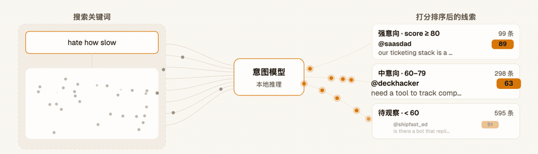
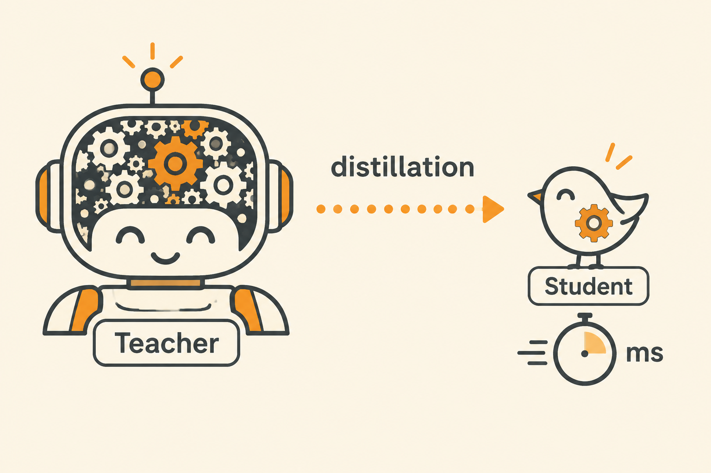
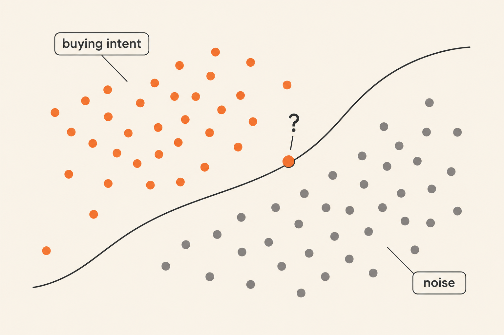
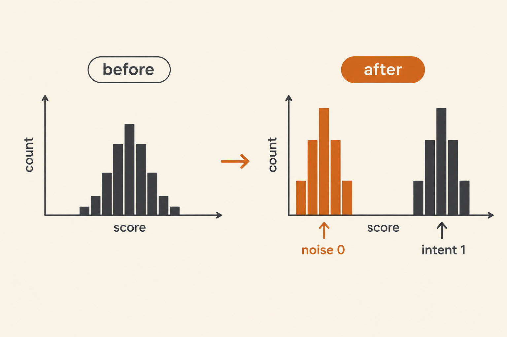
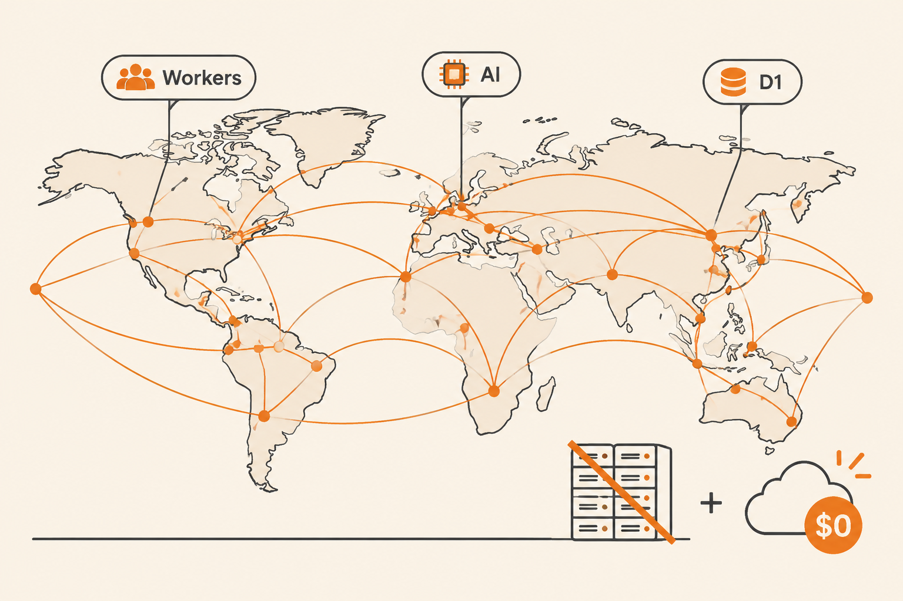

# 我在 X 上装了个"买家雷达"：本地推理、零服务器、月成本 $0

每天，有几千人在 X（Twitter）上公开"喊话"——

"is there an app that can track my competitor pricing?"
"anyone recommend a good CRM for a small agency?"
"I wish there was a tool that auto-sends invoices."

这些是明牌的购买信号。发帖的人在向全世界宣告：**我要买一个解决方案**。

问题是，这些帖子混在信息流的噪音里——夹在"推荐我几部好看的动漫"和"周一加油"之间——没人接得住。

我写了一个系统，实时盯这些帖子，给每条打上 0-1 的购买意向分——判断跑在一个本地小模型上，单条 0.03 秒，每月成本 0 元。

这篇文章记录我从零到上线走过的完整链路——按"账 → 老师 → 空间 → 数据 → 训练 → 上线"的顺序，一层一层深入。

先看线上实拍（GIF 录自真实运行中的系统）：



*搜索词命中 → 线索入池 → 模型打分 → 强/中/待观察三档，全程真实数据。体验地址：[x-lead-miner.ideaguard.dev](https://x-lead-miner.ideaguard.dev)*

## 先算一笔账

最常见的方案：每条帖子发给 GPT，问"这条有没有购买意向？"

按 2026 年 11 月的最新牌价算笔细账（每条判断约 300 输入 + 30 输出 token；监控系统 50 条/分钟 = 7.2 万条/天连续运行）：

| 大模型 API | 牌价（输入/输出 每百万 token） | 月成本（7.2 万条/天） |
| --- | --- | --- |
| GPT-6.2 Astra（现役旗舰） | $8 / $40 | **约 $7,780** |
| GPT-6.2 Sol | $2 / $10 | **约 $1,940** |
| GPT-6.1 Terra | $1 / $5 | **约 $970** |
| GPT-6 Luna（最新一代轻量） | $0.10 / $0.50 | **约 $97** |

> 牌价取自 OpenRouter 实时接口（2026-11-21）；旗舰代际更替后价格不降反升，成本区间从 $97 拉开到 $7,780。

最新一代确实把价格打了下来——但 $100/月只是最浅的一层账。真正拉开差距的是另外几项：

| 方案 | 月成本 | 单条延迟 | 判断标准 | 确定性 | 数据去向 |
| --- | --- | --- | --- | --- | --- |
| 大模型 API（任意档位） | $97 ~ $7,780 | 1-3 秒 | 提示词，随时可被供应商调整 | 有非确定性波动 | 发给第三方 |
| 商业社交监听 SaaS | $99-499 | 小时级轮询 | 黑盒 | 黑盒 | 存在对方平台 |
| 本方案（领域蒸馏小模型） | **$0** | **0.03 秒** | 写死在自己的代码里，可审计可回归 | 同输入永远同分数 | 自托管 |

对做线索挖掘的团队来说，这张表就是商业模型本身：**判断成本归零之后，监控才能铺满所有关键词组合、7×24 小时不限流地跑**——监控铺得越广、响应越快，捞到买家越早。延迟 30 倍的差距（0.03 秒对 1-3 秒）和"判定标准永远在自己手里"这两点，在高频场景里比省下的订阅费更值钱。

## 大模型当老师，小模型练本能

认知科学里有个漂亮的框架，叫 **System 1 / System 2**：

- **System 2**（慢思考）：大模型。判断力强，但每答一次都要花钱、花时间。
- **System 1**（快直觉）：小模型。毫秒级出结果，几乎免费。

策略由此而来：**先让 System 2 把 7,866 条帖子逐一判断一遍，再让 System 1 照着答案练习**——把大模型的判断力"蒸馏"成小模型的直觉。



前 OpenAI 研究者 Diogo Almeida 创立的 TypeSafe AI 在 2026 年把这个概念产品化了（他们叫 System One Models）。我用同样的思路做了一个领域专用版，并且全程开源。

## 基模：先借一双"读懂语言"的眼睛

小模型要判断帖子，得先"读懂"帖子。从零训练一个语言理解模型？那是几十万张卡的事。

聪明的做法是**站在现成的嵌入模型肩膀上**。这类模型经过海量语料预训练，能把任何一句话变成空间里的一个点——语义越接近的点，挨得越近。

在这个空间里，"求推荐 CRM"和"找发票工具自动化"会自然地聚在一起，而"推荐几部动漫"会待在另一个角落。也就是说：**购买意向和噪音，在这个空间里本来就各自抱团**。



我们要做的，只是画一条分界线。

## 数据：两个桶，一个灵魂设计

为了让这条分界线清晰，我给数据集设计了两个桶：

- **意向桶**：抓"求推荐工具"、"I wish there was an app"、"alternative to" 这类明确信号
- **噪音桶**：故意抓表面相似、实际无关的帖子——"recommend me some anime"、"just shipped a new feature"

噪音桶是整个数据集的灵魂。少了它，模型会学到一条偷懒的浅规则——"帖子里有 recommend 就给高分"。有了它，模型被迫去理解句子的**意图**，而这么多个匹配的**关键词**。

标注由 Gemini 2.5 Flash 担任 teacher，每条帖子标三个字段：意向（布尔）、类型（求推荐/找替代/抱怨/功能愿望/纯夸/噪音）、置信度（0-1）。最终 7,866 条：2,850 条意向、5,016 条噪音。

## 训练：一个 49k 参数的小头，和两个坑

有了数据，训练对象是一个极小的决策头：**768 → 64 → 1 的 MLP，共 49,281 个参数（约 0.00005B）**。基模（负责把文本变成 768 维向量）完全冻结，一个参数都不动。


流程看着简单，路上却有两个坑。个个都值一节课。

#### 训练配置全貌（本地 CPU 实测）

| 项 | 值 |
| --- | --- |
| 硬件 | MacBook 本地 CPU，全程无 GPU |
| 框架 | PyTorch |
| 结构 | 768 → 64 → 1 的 MLP，共 49,281 个参数 |
| 损失函数 | BCEWithLogitsLoss |
| 优化器 | Adam，学习率 1e-3 |
| batch 大小 | 16 |
| epoch | 上限 200，早停 patience=20，实际 40 轮收敛 |
| 随机种子 | 7（切分与初始化全部定死，结果可复现） |
| 数据切分 | 分层抽样：训练 5,508 / 验证 1,179 / 测试 1,179 |
| 类别分布 | 2,850 条意向 / 5,016 条噪音 |
| 全程耗时 | **3 分 41 秒**（含 7,866 条向量化 + 40 轮训练 + 测试集评估） |
| 产物 | head.pt，199KB |

两个让训练"便宜到忽略不计"的工程决策：

**向量化只算一次。** 7,866 条帖子先整体过一遍冻结基模，768 维向量全部缓存落盘。训练时小头直接读向量——它要学的只是"在这个语义空间里画边界"，完全没必要每轮重算基模。

**一切定死种子。** 切分 seed=7、初始化 seed=7，任何人拿同一份数据重跑，得到的模型逐位一致。机器学习实验最怕"跑两次结果不一样"，这里从根上杜绝。

### 坑一：Teacher 标签倒挂

第一版模型训练完，指标漂亮：测试集 precision@5 = 1.00，"前 5 条全是精准线索"。

直到我人工抽查了 50 条。

41 条被标为"意向"的帖子里，混着大量这样的内容：

"recommend me some anime to watch"
"recommend a good book for the weekend"

这些都是**内容消费**，跟买解决方案毫无关系。而真正的意向——"I wish there was an app that could X"——反而被标成了噪音。

根因：teacher 的提示词只说了"判断是否有购买意向"，Gemini 看到 "recommend" 就条件反射给高分。它没区分"推荐一个可以买的东西"和"推荐一个可以看的东西"。

修复：在提示词里写死正反锚定示例。

```
✓ true: "anyone recommend a CRM for my agency"
✓ true: "wish an app tracked my subscriptions"
✗ false: "recommend me some anime"
✗ false: "recommend a good youtuber"
```

只改了两行提示词，重标全部数据，问题消失。

**教训：蒸馏的质量上限 = teacher 的质量上限。先审计 teacher，再训练模型。**

### 坑二：49K 参数也会"训练不足"

修复标签后重训，指标依然不对——模型把所有帖子的分数都挤在 0.25-0.40 之间，判别力为零。

检查训练代码，发现了一个尴尬的事实：

```python
for epoch in range(30):
    loss.backward()
    optimizer.step()
```

全批量训练，30 个 epoch——总共只走了 **30 步梯度更新**。一个 49k 参数的头在 5,000 条样本上走 30 步，相当于让一个学生只上了半节课就去考试。

修复：mini-batch（batch=16）+ 早停（patience=20），梯度更新次数从 30 涨到数千。train_loss 从 0.63 降到 0.01，test accuracy 从 0.757（全预测为负的基线）升到 0.877。



**教训：参数少不等于好训练。小模型的训练动力学要单独算清楚。**

顺带一提，训练完的整个模型文件只有 199KB——这个体积在后面部署环节会派上大用场。

### 附记：换基模 = 重训头

部署阶段还有个工程取舍：最初用的基模（embeddinggemma-2，7.4 亿参数）在本地效果很好，体积却装不进边缘运行时。最终线上换成了 Cloudflare Workers AI 托管的 **bge-base-en-v1.5**（1.09 亿参数，768 维），用同样的数据重训了一个头，测试集 accuracy 还涨到了 0.886。

这也让我彻底理解了一件事：**决策头和基模是死绑的**——头学的是"这个基模的语义空间里，哪条边界分隔意向与噪音"。换基模，空间就换，头必须重训。好在重训只要几分钟。

## 效果

最终数据集：7,866 条标注帖子（2,850 意向 / 5,016 噪音）。

三路分层切分：5,508 训练 / 1,179 验证（早停用）/ 1,179 测试（从未参与训练和选模）。

| 指标 | 验证集 | 测试集 |
| --- | --- | --- |
| precision@5 | 1.00 | 1.00 |
| precision@10 | 1.00 | 0.70 |
| accuracy | 0.889 | 0.877 |

诚实声明：以上指标度量的是**模型与 teacher 的一致率**。teacher 对人类判断的一致率约 90%（50 条人工审计），所以真实准确率的上限也在这个附近。我们选择公开这个口径——诚实的数字比漂亮但不真实的数字更有价值。

线上实测判别：

| 帖子 | 分数 | 判定 |
| --- | --- | --- |
| "is there an app that tracks competitor pricing daily? willing to pay" | 0.9964 | 强意向 |
| "looking for a cheaper alternative to Ahrefs" | 0.8094 | 强意向 |
| "just watched the new Dune movie" | 0.0162 | 噪音 |
| "can anyone recommend me some cool youtubers to watch?" | 0.0002 | 噪音 |

## 部署：整套系统跑在 Cloudflare 免费档上

线上地址：**[https://x-lead-miner.ideaguard.dev](https://x-lead-miner.ideaguard.dev)**

Cloudflare 提供了一整套对个人开发者极度友好的免费资源，这个系统全部用上了：

- **Workers**（计算）：免费档每天 10 万次请求——搜索、打分、页面渲染全在这里
- **Workers AI**（模型推理）：bge-base 基模原生托管，按"神经元"计费，免费额度内绰绰有余
- **D1**（存储）：免费档 SQLite，存线索库和会话
- **全球边缘网络**：部署即复制到 300+ 城市的节点，用户永远访问最近的那台
- **自定义域名 + 自动 HTTPS**：绑定即用

工作流：push 到 GitHub → Actions 免费 runner 构建（45 秒）→ 自动上线；构建失败自动熔断不上线。本地零构建、零服务器，**月账单 $0**。



## 和行业的呼应

"小模型做类型化决策"正是 2026 年行业最热的方向之一。前 OpenAI 研究者 Diogo Almeida 创立的 TypeSafe AI 推出的 System One 模型 **Jev** 是这个赛道的代表产品——发布后在开发者社区刷了屏，也是我们开发这套系统时一直对标的基准：它验证了这条路线的商业价值，我们要回答的是，在自己的场景里，领域蒸馏能不能跑出更好的数字。

上线之后，我用 Jev 官方 API 和我们的小头在同一批 held-out 数据上做了正面对比——300 条样本上，我们的一致率 0.92、单条延迟 0.03 秒；Jev 官方 API 是 0.80、0.87 秒。完整的方法、过程和逐条数据都开源在仓库的 `reports/` 目录里，可自行复核。

## 开源

全部代码、数据集（匿名化）、模型权重和这篇文章的大纲都在 GitHub 上：

- 管线 + 数据集：github.com/flashclub/x-lead-intent-pipeline
- SaaS：github.com/flashclub/x-lead-miner
- HF 模型：huggingface.co/flashcoder/tweet-buy-intent
- HF 数据集：huggingface.co/datasets/flashcoder/tweet-buy-intent-leads

**大模型负责判断力，小模型负责本能。**

下一步：把模型转成 ONNX，让招聘者的浏览器自己跑推理——零服务器、零 API、零成本。
