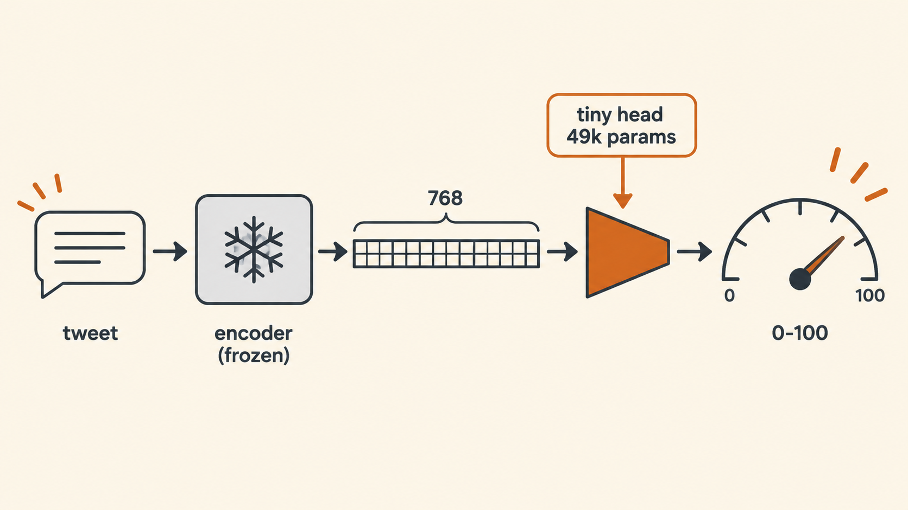

# 当大家都在训练 70B，我训练了一个 5 万参数的小模型——让它在 X 上找买家

每天，有几千人在 X（Twitter）上公开"喊话"——

"is there an app that can track my competitor pricing?"
"anyone recommend a good CRM for a small agency?"
"I wish there was a tool that auto-sends invoices."

这些是明牌的购买信号。发帖的人在向全世界宣告：**我要买一个解决方案**。

问题是，这些帖子混在信息流的噪音里——夹在"推荐我几部好看的动漫"和"周一加油"之间——没人接得住。

我写了一个系统，实时盯这些帖子，用一个**只有 5 万参数的小模型**给每条打上 0-1 的购买意向分——个头只有主流大模型的百万分之一。推理在 CPU 上跑，单条不到 0.1 秒。

这篇文章记录我从零到上线走过的完整链路——按"账 → 老师 → 空间 → 数据 → 训练 → 上线"的顺序，一层一层深入。

## 先算一笔账

最常见的方案：每条帖子发给 GPT，问"这条有没有购买意向？"

假设你的监控系统每分钟扫 50 条帖子：

- GPT-4 级 API：约 $0.01/条 → **$720/天**
- 最便宜的 Flash 级模型：约 $0.001/条 → **$72/天**

一个月 $2,160，外加每次网络往返的延迟。产品要实时响应时，这个成本结构撑不住。

而这类判断有一个特点：**标准极其固定**。"有没有购买意向"这个问题，一天之内答案的形状几乎不变。一个标准固定、量巨大的判断任务，正适合用一个专用小模型来做——把它练出来，之后每次判断几乎零成本。

## 大模型当老师，小模型练本能

认知科学里有个漂亮的框架，叫 **System 1 / System 2**：

- **System 2**（慢思考）：大模型。判断力强，但每答一次都要花钱、花时间。
- **System 1**（快直觉）：小模型。毫秒级出结果，几乎免费。

策略由此而来：**先让 System 2 把 7,866 条帖子逐一判断一遍，再让 System 1 照着答案练习**——把大模型的判断力"蒸馏"成小模型的直觉。


前 OpenAI 研究者 Diogo Almeida 创立的 TypeSafe AI 在 2026 年把这个概念产品化了（他们叫 System One Models）。我用同样的思路做了一个领域专用版，并且全程开源。

## 基模：先借一双"读懂语言"的眼睛

小模型要判断帖子，得先"读懂"帖子。从零训练一个语言理解模型？那是几十万张卡的事。

聪明的做法是**站在现成的嵌入模型肩膀上**。这类模型经过海量语料预训练，能把任何一句话变成空间里的一个点——语义越接近的点，挨得越近。

在这个空间里，"求推荐 CRM"和"找发票工具自动化"会自然地聚在一起，而"推荐几部动漫"会待在另一个角落。也就是说：**购买意向和噪音，在这个空间里本来就各自抱团**。


我们要做的，只是画一条分界线。

## 数据：两个桶，一个灵魂设计

为了让这条分界线清晰，我给数据集设计了两个桶：

- **意向桶**：抓"求推荐工具"、"I wish there was an app"、"alternative to" 这类明确信号
- **噪音桶**：故意抓表面相似、实际无关的帖子——"recommend me some anime"、"just shipped a new feature"

噪音桶是整个数据集的灵魂。少了它，模型会学到一条偷懒的浅规则——"帖子里有 recommend 就给高分"。有了它，模型被迫去理解句子的**意图**，而这么多个匹配的**关键词**。

标注由 Gemini 2.5 Flash 担任 teacher，每条帖子标三个字段：意向（布尔）、类型（求推荐/找替代/抱怨/功能愿望/纯夸/噪音）、置信度（0-1）。最终 7,866 条：2,850 条意向、5,016 条噪音。

## 训练：一个 49k 参数的小头，和两个坑

有了数据，训练对象是一个极小的决策头：**768 → 64 → 1 的 MLP，共 49,281 个参数（约 0.00005B）**。基模（负责把文本变成 768 维向量）完全冻结，一个参数都不动。



流程看着简单，路上却有三个坑。个个都值一节课。

### 坑一：Teacher 标签倒挂

第一版模型训练完，指标漂亮：测试集 precision@5 = 1.00，"前 5 条全是精准线索"。

直到我人工抽查了 50 条。

41 条被标为"意向"的帖子里，混着大量这样的内容：

"recommend me some anime to watch"
"recommend a good book for the weekend"

这些都是**内容消费**，跟买解决方案毫无关系。而真正的意向——"I wish there was an app that could X"——反而被标成了噪音。

根因：teacher 的提示词只说了"判断是否有购买意向"，Gemini 看到 "recommend" 就条件反射给高分。它没区分"推荐一个可以买的东西"和"推荐一个可以看的东西"。

修复：在提示词里写死正反锚定示例。

```
✓ true: "anyone recommend a CRM for my agency"
✓ true: "wish an app tracked my subscriptions"
✗ false: "recommend me some anime"
✗ false: "recommend a good youtuber"
```

只改了两行提示词，重标全部数据，问题消失。

**教训：蒸馏的质量上限 = teacher 的质量上限。先审计 teacher，再训练模型。**

### 坑二：49K 参数也会"训练不足"

修复标签后重训，指标依然不对——模型把所有帖子的分数都挤在 0.25-0.40 之间，判别力为零。

检查训练代码，发现了一个尴尬的事实：

```python
for epoch in range(30):
    loss.backward()
    optimizer.step()
```

全批量训练，30 个 epoch——总共只走了 **30 步梯度更新**。一个 49k 参数的头在 5,000 条样本上走 30 步，相当于让一个学生只上了半节课就去考试。

修复：mini-batch（batch=16）+ 早停（patience=20），梯度更新次数从 30 涨到数千。train_loss 从 0.63 降到 0.01，test accuracy 从 0.757（全预测为负的基线）升到 0.877。


**教训：参数少不等于好训练。小模型的训练动力学要单独算清楚。**

顺带一提，训练完的整个模型文件只有 199KB——这个体积在后面部署环节会派上大用场。

### 附记：换基模 = 重训头

部署阶段还有个工程取舍：最初用的基模（embeddinggemma-2，7.4 亿参数）在本地效果很好，体积却装不进边缘运行时。最终线上换成了 Cloudflare Workers AI 托管的 **bge-base-en-v1.5**（1.09 亿参数，768 维），用同样的数据重训了一个头，测试集 accuracy 还涨到了 0.886。

这也让我彻底理解了一件事：**决策头和基模是死绑的**——头学的是"这个基模的语义空间里，哪条边界分隔意向与噪音"。换基模，空间就换，头必须重训。好在重训只要几分钟。

## 效果

最终数据集：7,866 条标注帖子（2,850 意向 / 5,016 噪音）。

三路分层切分：5,508 训练 / 1,179 验证（早停用）/ 1,179 测试（从未参与训练和选模）。

| 指标 | 验证集 | 测试集 |
| --- | --- | --- |
| precision@5 | 1.00 | 1.00 |
| precision@10 | 1.00 | 0.70 |
| accuracy | 0.889 | 0.877 |

诚实声明：以上指标度量的是**模型与 teacher 的一致率**。teacher 对人类判断的一致率约 90%（50 条人工审计），所以真实准确率的上限也在这个附近。我们选择公开这个口径——诚实的数字比漂亮但不真实的数字更有价值。

线上实测判别：

| 帖子 | 分数 | 判定 |
| --- | --- | --- |
| "is there an app that tracks competitor pricing daily? willing to pay" | 0.9964 | 强意向 |
| "looking for a cheaper alternative to Ahrefs" | 0.8094 | 强意向 |
| "just watched the new Dune movie" | 0.0162 | 噪音 |
| "can anyone recommend me some cool youtubers to watch?" | 0.0002 | 噪音 |

## 部署

GitHub Actions（免费 runner，构建 45 秒）→ Cloudflare Workers（免费档）→ D1（免费档 SQLite）。push 即部署，构建失败自动熔断不上线。全程零服务器。

部署路上踩了五个一行配置就能修的坑：递归构建 OOM、入口路径错位、静态资源目录、Worker 运行时密钥、token 账户范围。叠在一起就是一整天的排查——这段经历值得单独写一篇。

## 和 Jev 的正面对比

写完之后我调研了行业，发现前 OpenAI 研究者 Diogo Almeida 创立的 TypeSafe AI 做的 System One 模型 Jev，和我们走的是同一个范式：小模型做类型化决策，替代 LLM 调用。既然是同一个赛道，那就直接摆擂台——用它家官方 API，和我们 5 万参数的小头，在同一批数据上正面对比。

### 测试方法

- **数据**：7,866 条标注数据按训练时同款切分还原出的 held-out test 集（模型从未见过），确定性分层抽样 300 条：96 条意向 / 204 条噪音
- **参考基准**：teacher 标签（Gemini 2.5 Flash）；teacher 对人工判断的一致率约 90%
- **判定阈值**：0.5
- **Jev 侧**：TypeSafe 官方 API（System One 协议），模型 jev-latest（实际服务版本 jev-1.14.0），判定标准按"作者是否想购买/采用/付费某个产品、工具或服务"写死在请求里，单条逐请求
- **极性验证**：先拿两条极端帖子校准——强意向帖 Jev 打 0.93，纯噪音帖打 0.08，方向确认无误才开跑
- **我方**：同一个 300 条、同一个 0.5 阈值，本地 CPU 推理

### 测试过程

每个模型对同一批 300 条逐一打分，600 次判断全程落盘：每条的双方分数、判定、对错、耗时都存进 CSV，可逐条复核。Jev 每条含网络往返约 0.87 秒，我们的头每条约 0.03 秒——整个对比 Jev 侧跑了约 5 分钟，我方 10 秒。

### 测试结论

| 模型 | 一致率 | ROC-AUC | 精确率 | 召回率 | F1 | 单条延迟 |
| --- | --- | --- | --- | --- | --- | --- |
| 我们的 49k 头 | **0.92** | **0.952** | 0.875 | **0.875** | **0.875** | **0.033s** |
| Jev（jev-latest） | 0.80 | 0.860 | 0.891 | 0.427 | 0.576 | 0.873s |

两个模型都做到了"前 5 条全是精准线索"（precision@5 = 1.00），但拆开看是两种完全不同的性格：

**Jev 是极端保守型**。它很少误报（精确率 0.891），代价是 55 条真正的意向帖被它漏掉了——召回率只有 0.427，一半以上的买家从它眼皮底下溜走。

**我们的头两端均衡**（0.875 / 0.875）。在 lead mining 这个场景里，漏掉一个买家的代价远大于多看一条噪音——召回端的差距（0.875 对 0.427）比总体一致率更能说明问题。

诚实口径照旧：以上是模型与 teacher 的一致率，而 teacher 对人工判断的一致率约 90%。另外 Jev 两次运行的总体一致率在 0.80-0.81 之间小幅波动（其 API 非确定性），我们取了后一次的完整数据。

## 开源

全部代码、数据集（匿名化）、模型权重和这篇文章的大纲都在 GitHub 上：

- 管线 + 数据集：github.com/flashclub/x-lead-intent-pipeline
- SaaS：github.com/flashclub/x-lead-miner
- HF 模型：huggingface.co/flashcoder/tweet-buy-intent
- HF 数据集：huggingface.co/datasets/flashcoder/tweet-buy-intent-leads

**大模型负责判断力，小模型负责本能。**

下一步：把模型转成 ONNX，让招聘者的浏览器自己跑推理——零服务器、零 API、零成本。
